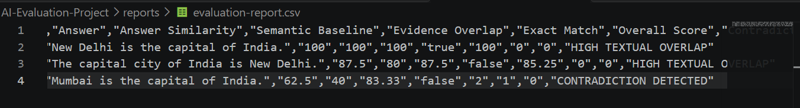

# AI Evaluation and Hallucination Detection System

**Copyright © 2026 ANUBOLU YASWANTH. All Rights Reserved.**

A JavaScript-based prototype for evaluating AI-generated responses through answer evaluation, evidence checking, claim verification, contradiction detection, and automated reporting.

## Project Overview

The AI Evaluation and Hallucination Detection System is designed to assess the reliability and quality of AI-generated answers.

It provides a structured evaluation framework that examines responses against expected information and available evidence. The system also identifies potentially unsupported or contradictory claims and generates evaluation reports.

## Evaluation Report Preview

The screenshot below shows a sample evaluation report generated by the project.



## Key Features

- **Answer Evaluation:** Evaluates AI-generated answers against expected information.
- **Evidence Checking:** Examines whether answers are supported by available evidence.
- **Claim Verification:** Identifies matching and potentially contradictory claims.
- **Hallucination Detection:** Flags unsupported or questionable statements using the implemented checks.
- **Batch Evaluation:** Evaluates multiple responses in one execution.
- **Semantic Evaluation:** Includes a baseline for semantic similarity evaluation.
- **Automated Testing:** Provides test cases for important system components.
- **Evaluation Reports:** Generates evaluation results in JSON and CSV formats.

## Technology Stack

- JavaScript
- Node.js
- JSON
- CSV
- Git
- GitHub
- PowerShell

## Project Structure

```text
AI-Evaluation-Project/
│
├── src/
│   ├── detectors/
│   ├── evaluators/
│   └── knowledge/
│
├── tests/
│
├── reports/
│   ├── evaluation-report.csv
│   └── evaluation-report.json
│
├── docs/
│   ├── ARCHITECTURE.md
│   └── AI-Evaluation-Report.png
│
├── LICENSE
├── COPYRIGHT
├── README.md
├── .gitignore
├── package.json
└── run-tests.ps1
```

## Getting Started

### Prerequisites

- Node.js
- Visual Studio Code (recommended)
- Git (for version control)

### Setup

1. Clone or download this repository.
2. Open the project folder in Visual Studio Code.
3. Open the integrated terminal.
4. Run the evaluation engine:

```bash
node src/evaluators/evaluationEngine.js
```

### Run Automated Tests

Run the project test script:

```powershell
.\run-tests.ps1
```

The test script executes the available automated test suites.

## Sample Evaluation

The prototype includes sample AI-generated responses to demonstrate how its evaluation checks work.

| Sample Response | Evaluation Result |
|---|---|
| Model A | Ranked 1 |
| Model C | Ranked 2 |
| Model B | Ranked 3 |

The sample evaluation demonstrates how the system can identify a contradictory answer even when it shares words with the available evidence.

**Note:** This is a prototype that uses sample responses and a local knowledge base. Its current evaluation methods are heuristic and baseline-based; results should not be interpreted as definitive proof of factual correctness or as a replacement for human review.

## Project Status

The initial evaluation engine, evidence checking, claim verification, batch evaluation, reporting, and automated testing components have been implemented.

The project is under continued development, with opportunities to extend its evaluation methods and integrate external AI models in future versions.

## Architecture

For an overview of the system design and component organization, see:

[View Project Architecture](docs/ARCHITECTURE.md)

## Copyright and License

**Copyright © 2026 ANUBOLU YASWANTH. All Rights Reserved.**

This repository is publicly available for portfolio and demonstration purposes.

The original source code, architecture, evaluation logic, documentation, and associated project materials are protected by applicable copyright law.

No permission is granted to copy, reproduce, modify, redistribute, sublicense, or commercially exploit the original project materials without prior written permission from the copyright holder, except where applicable law provides otherwise.

See the [LICENSE](LICENSE) and [COPYRIGHT](COPYRIGHT) files for details.

Third-party libraries and dependencies remain subject to their respective licenses.

---

**Developed by ANUBOLU YASWANTH**

AI Evaluation and Hallucination Detection System | 2026