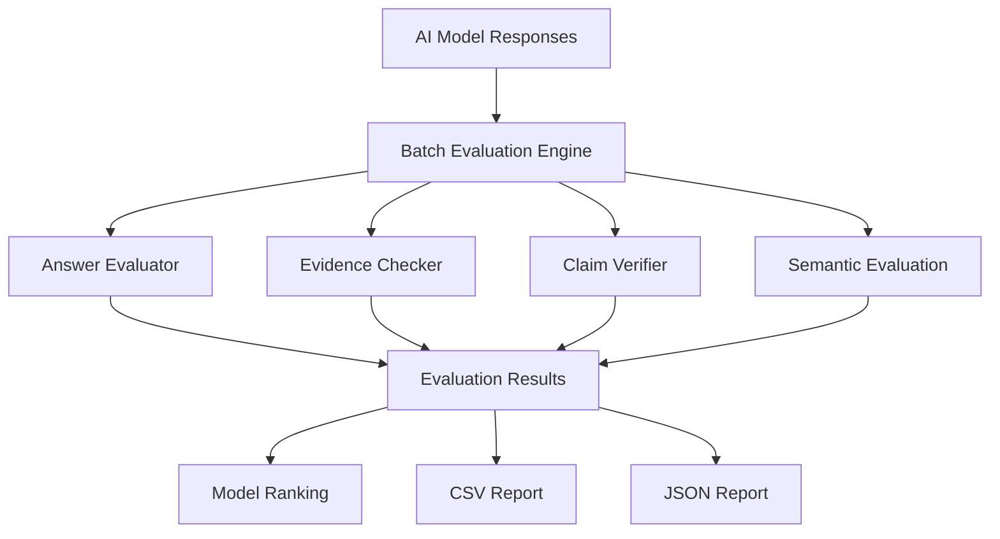

# AI Evaluation and Hallucination Detection System — Architecture

## 1. Project Overview

This project evaluates AI-generated answers using multiple evaluation techniques. It compares model responses, checks evidence support, identifies contradictions, and generates structured evaluation reports.

## 2. Conceptual Architecture

## 3. Main Components

- **Batch Evaluation Engine:** Coordinates the evaluation of multiple model responses.
- **Answer Evaluator:** Compares generated answers against expected answers.
- **Evidence Checker:** Examines how well answer content matches available evidence.
- **Claim Verifier:** Checks claims for supporting evidence and contradictions.
- **Semantic Evaluation:** Provides a baseline for comparing answer meaning.
- **Report Generator:** Produces structured CSV and JSON evaluation reports.

## 4. Evaluation Workflow

1. Provide responses from multiple AI models.
2. Run the batch evaluation process.
3. Evaluate answer similarity and evidence overlap.
4. Check claims for contradictions and insufficient evidence.
5. Calculate evaluation scores.
6. Rank the evaluated model responses.
7. Generate CSV and JSON reports.

## 5. Output

The system produces structured results that help compare model responses and identify answers requiring further review.

## 6. Important Limitation

The evaluation scores are based on the project's implemented comparison and verification logic. They should not be treated as a guarantee of factual accuracy. Human review and stronger evidence sources are important for reliable evaluation.

## 7. Technology

- JavaScript
- Node.js
- Git and GitHub
